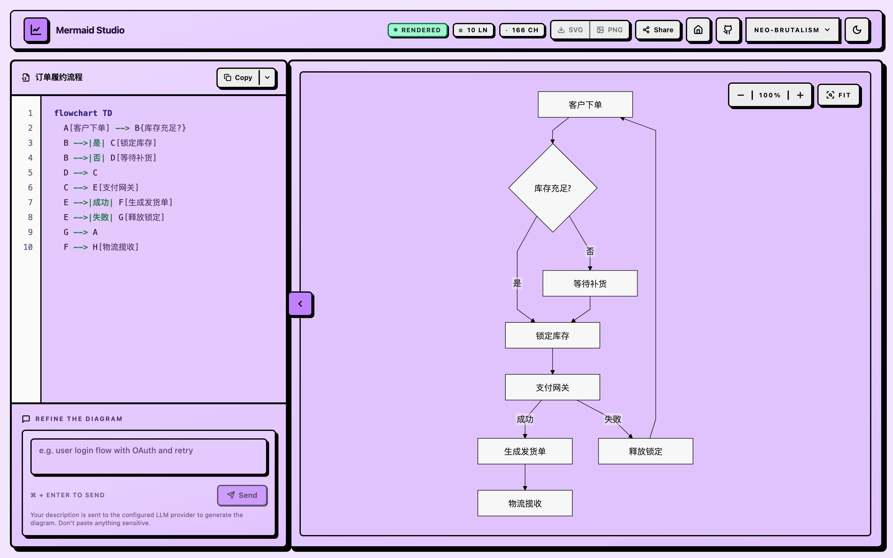
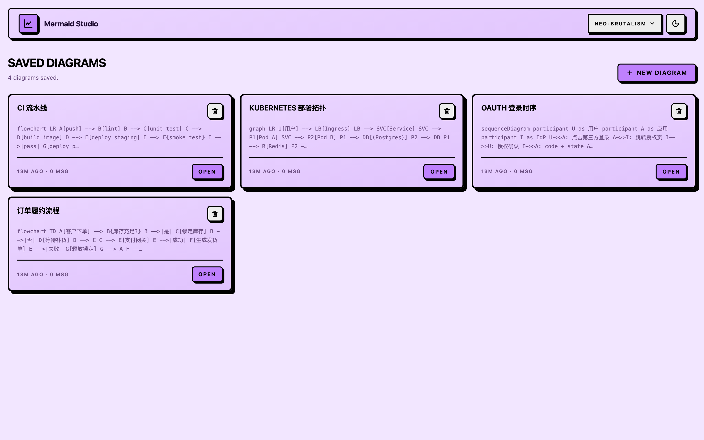
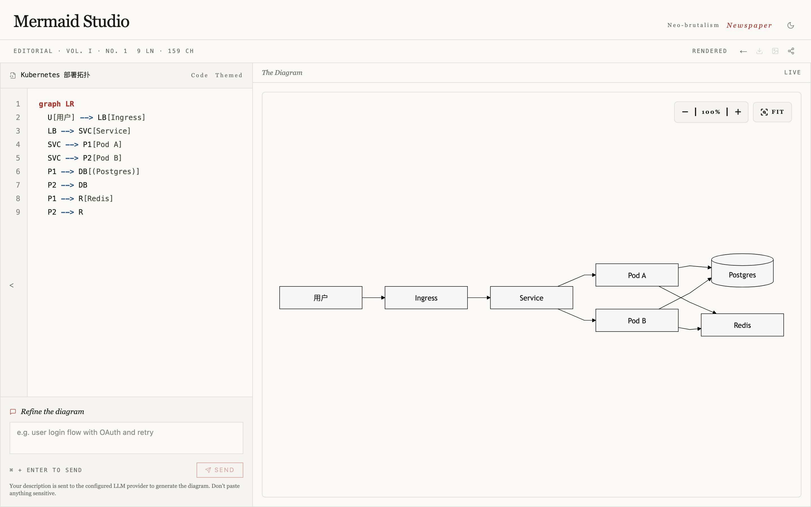
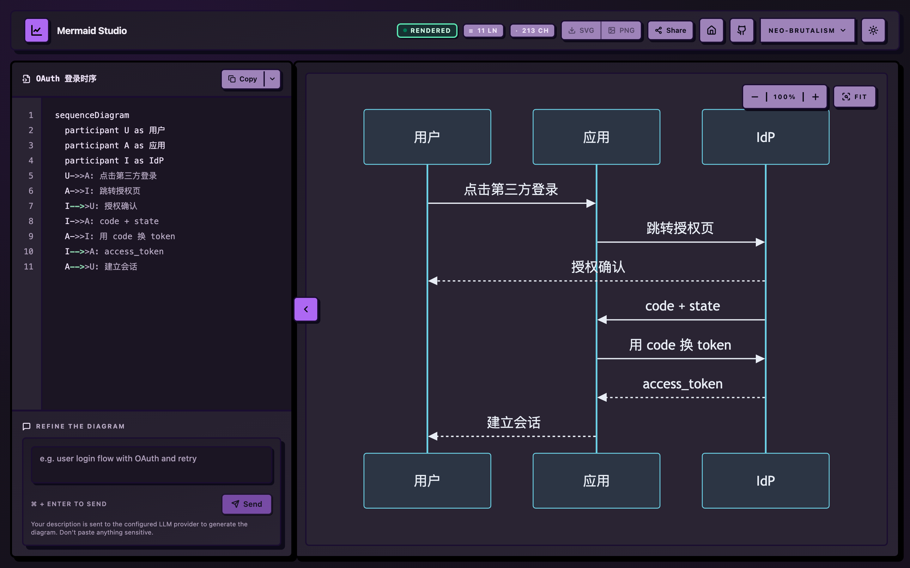

# Mermaid Studio

**A self-hostable studio for Mermaid diagrams.** Describe a diagram in plain
language, then keep refining it in conversation — or edit the Mermaid source
directly in a code-first editor. Every diagram is stored as a conversation, so
you can come back to it later and keep nudging it.

<p align="center">
  
</p>

## Why another Mermaid tool?

Most "AI diagram" products are a chat box in front of a model, on someone
else's server, tied to someone else's account. Mermaid Studio is the
opposite trade:

- **Self-hosted by default.** A single Node process and a SQLite file. Your
  diagrams are stored on your own server, not on someone's account.
- **Bring your own model key.** Point it at any Anthropic-Messages-compatible
  or OpenAI-compatible endpoint — including a relay or a local gateway.
  Nothing is proxied through us.
- **Conversational revision, not one-shot generation.** The diagram is edited
  *in place* across turns ("make the arrows dashed"), with the whole
  transcript kept.
- **Code-first.** The editor is the product: real syntax highlighting, line
  numbers, current-line tracking, and click-a-node-to-jump-to-its-source.

> **What leaves your server.** Chatting sends your prompt — and the current
> diagram, as conversation context — to whichever model endpoint you
> configured. The editor says so under the composer. Editing and exporting
> never make a network call.

## Features

- **Chat-to-diagram** with multi-turn editing; the title is generated once and
  never silently overwritten.
- **Three-layer code editor** — gutter, tokenized overlay, transparent
  textarea — so the caret sits exactly on the glyph it belongs to.
- **Click a node in the preview** to select the matching line of source.
- **Pan / zoom / fit** preview, with a floating zoom toolbar.
- **SVG and PNG export.** The PNG bakes in the theme background so the file
  does not turn transparent in a viewer.
- **Shareable links.** The source is compressed into the URL fragment, so it
  never touches the server.
- **Two UI styles** (`neo-brutalism`, `newspaper`), light and dark, selected
  per visit with `?ui-style=`.
- **Auto-save** with a trailing debounce; a pending write is flushed when the
  tab is hidden.
- **Rate limiting and a strict CSP** on every route.

## Screenshots

| | |
|---|---|
|  <br> Saved diagrams, with source previews |  <br> The editor, neo-brutalism |
|  <br> The editor, newspaper |  <br> Dark mode |

## Quick start

Requires **Bun** (package manager and task runner) and **Node 22.13+** on
`PATH` (24 recommended) — the app uses Node's built-in `node:sqlite`, and the
`bun run` scripts hand off to the `next` binary, which runs under Node.

```bash
git clone https://github.com/suisj1999/mermaid-studio.git
cd mermaid-studio
bun install

cp .env.example .env.local   # then add a provider key
bun run dev                  # http://localhost:3000
```

To generate diagrams you need a model key in `.env.local`. Either provider
works:

```bash
# Anthropic-Messages-compatible (including relays)
ANTHROPIC_COMPATIBLE_API_KEY=sk-...
ANTHROPIC_COMPATIBLE_BASE_URL=https://api.anthropic.com
ANTHROPIC_COMPATIBLE_MODEL=claude-haiku-4-5

# or OpenAI-compatible
OPENAI_COMPATIBLE_API_KEY=sk-...
OPENAI_COMPATIBLE_BASE_URL=https://api.openrouter.ai/api/v1
OPENAI_COMPATIBLE_MODEL=anthropic/claude-3.5-haiku
```

Editing and exporting work without any key at all — only chat needs one.

## Configuration

All variables are optional; the defaults are listed.

| Variable | Default | Meaning |
|---|---|---|
| `NEXT_PUBLIC_SITE_URL` | `http://localhost:3000` | Public origin. Feeds the canonical link, Open Graph URLs, `robots.txt` and `sitemap.xml`. **Set this in production** or every canonical URL points at localhost. |
| `ANTHROPIC_COMPATIBLE_API_KEY` | – | Anthropic-Messages-compatible key. |
| `ANTHROPIC_COMPATIBLE_BASE_URL` | – | Endpoint for the above. |
| `ANTHROPIC_COMPATIBLE_MODEL` | `claude-haiku-4-5` | Model id. |
| `OPENAI_COMPATIBLE_API_KEY` | – | OpenAI-compatible key. |
| `OPENAI_COMPATIBLE_BASE_URL` | `https://api.openrouter.ai/api/v1` | Endpoint for the above. |
| `OPENAI_COMPATIBLE_MODEL` | `anthropic/claude-3.5-haiku` | Model id. |
| `DATABASE_PATH` | `./data/mermaid-studio.db` | SQLite file. Point it at a persistent volume in production. |
| `AUTOSAVE_INTERVAL_MS` | `2000` | Debounce for the title/source auto-save. `0` disables it; values below `500` are clamped to `500`. |
| `DEFAULT_OWNER_ID` | `default` | Owner every conversation belongs to. The app is single-user today. |
| `PORT` | `3000` | HTTP port for `next start`. |

## Deploying

The app is a standard Next.js server. Build and run it like any other Node
app:

```bash
bun install --frozen-lockfile
bun run build
bun run start          # honours PORT
```

Things to know before you put it in front of people:

- **The database is a file.** Point `DATABASE_PATH` at a persistent volume.
  On an ephemeral or serverless filesystem the data does not survive a
  redeploy.
- **The app is single-user.** Every conversation belongs to
  `DEFAULT_OWNER_ID`. It is one column away from being multi-user, but it is
  not multi-user today — do not expose it to the open internet as-is.
- **The LLM calls cost money** and are metered per client by the built-in
  rate limiter (see `server/rate-limit.ts`). Put it behind your own auth if it
  is reachable publicly.
- **Only one process may own `.next/`.** `next build` and `next dev` share the
  directory; running both at once corrupts the running server.

Behind a reverse proxy, forward `X-Forwarded-*` and set `NEXT_PUBLIC_SITE_URL`
to the public origin so canonical URLs and the sitemap are correct.

## Architecture

```
app/
  page.tsx                  # home — lists saved conversations (reads the DB directly)
  editor/page.tsx           # the editor; ?c=<id> opens a saved conversation
  api/chat/                 # POST — multi-turn generate + persist + title
  api/conversations/        # POST (create), PATCH/DELETE (auto-save, delete)
components/
  code-editor.tsx           # the three-layer editor
  diagram.tsx               # Mermaid renderer, sanitizer, pan/zoom host
  styles/<style>/           # per-style UI: page + theme.css, lazily loaded
hooks/                      # conversation state, auto-save, viewport, gestures
lib/                        # pure modules: mermaid helpers, share codec, conversations
server/                     # LLM pipeline, SQLite repository, rate limiter
```

A few invariants worth knowing before you change something:

- **The Mermaid source is stored exactly once**, in `conversations.source`. The
  transcript holds prompts, not a second copy of the diagram.
- **The editor's caret layer and paint layer must lay text out identically**
  (same font, wrapping, tab stops), or the caret drifts away from the glyph.
- **Shared components must not hard-code colours.** They reference neutral
  `.surface-*` classes that each `theme.css` defines.
- **Never open the database at module scope.** `next build` imports route
  modules while collecting page data, which would create a stray database file
  at build time.

`CLAUDE.md` documents the architecture and its traps in full — it is the
better reference.

## API

| Route | Purpose |
|---|---|
| `POST /api/chat` | `{ conversationId?, prompt }` → generate, persist, return the diagram, title and transcript. |
| `POST /api/conversations` | Create a conversation. |
| `PATCH /api/conversations/[id]` | Auto-save `{ title?, source? }`. |
| `DELETE /api/conversations/[id]` | Delete a conversation. |
| `POST /api/generate` | Legacy one-shot generation. Kept working, unused by the editor. |

Rate limits per client per minute: chat `10`, generate `10`, conversation
create `10`, auto-save `120`, delete `30`.

## Adding a new UI style

Styles are code-isolated folders. To add one:

1. Create `components/styles/<id>/` with a `theme.css` (tokens + `.surface-*`
   classes), a `HomePage.tsx` and an `EditorPage.tsx`.
2. Provide all three shared surface classes — `.surface-stamp`,
   `.surface-button-muted`, `.surface-interactive-layer` — or the shared
   components will render unstyled in that style.
3. Register it in `components/styles/registry.ts` (`STYLE_PAGES`) and add its id
   to `components/styles/ids.ts`.

The style folder is loaded with `next/dynamic`, so only the selected style's
CSS and JS ship to the browser.

## Scripts

```bash
bun run dev        # next dev
bun run build      # next build
bun run start      # next start
bun run typecheck  # tsc --noEmit
bun run test       # bun test
```

Tests cover the pure modules only. `bun test` runs under Bun, which does not
implement `node:sqlite`, so **no test may import `server/db/*`**.

## Contributing

Issues and pull requests are welcome. CI runs typecheck, tests and a
production build on every push, so a green PR is a mergeable one.

Before you start:

- `bun run typecheck` and `bun run test` must pass.
- UI changes need a browser check — `bun run dev` and click through it.
- Colour tokens are HSL triplets (`--paper-ink: 0 0% 10%`), never hex: they
  are consumed as `hsl(var(--token))`, and a hex value makes that expression
  invalid at computed-value time.
- Read `CLAUDE.md` first — it explains the constraints that are easy to break.

Wanted contributions:

- **A Docker image and a compose file.** The deployment recipe above is
  verified; a container is not, so it is not shipped. It is the most requested
  piece for self-hosting.
- **More UI styles** — see "Adding a new UI style" above.
- **An MCP server or a public render endpoint**, so coding agents can generate
  diagrams directly.

## License

MIT. See [LICENSE](LICENSE).

Mermaid itself is licensed under the MIT License, © [Mermaid](https://mermaid.js.org/).
